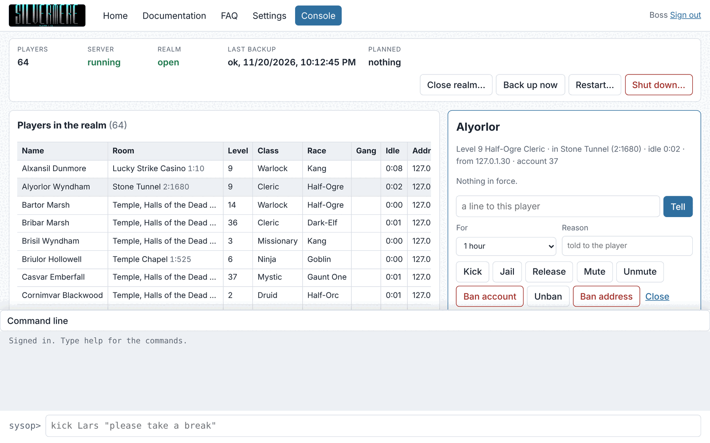

# Web pages (`silvermere-web`)

The server has a small web site of its own: this documentation, the [FAQ](faq.md), an
editor for the settings and the sysop's [console](#the-console). It listens on `server.web_bind`, `127.0.0.1:8088` by default: open
`http://127.0.0.1:8088` in a browser on the computer the server runs on.

| Page | What | Who |
|---|---|---|
| `/` | where to start | anyone who can reach the port |
| `/docs` | the documentation of the version that is running | anyone |
| `/faq` | the FAQ | anyone |
| `/settings` | every setting, with its description, default and where its value comes from | a sysop, signed in |
| `/console` | the players, moderation, the server's state and a command line, live | a sysop, signed in |

The pages are part of the program: they are built from `docs/` when the server is compiled, so
they always describe the version that is running, and they need no network.

## Settings

Sign in with the name and password of a game account that has the sysop role
(`silvermere account create NAME --sysop`, or `silvermere account grant NAME sysop`). Signing
in here does not take the account's place in the game. Ten wrong passwords for an account
within 15 minutes lock this sign-in for 15 minutes. Signing in opens the console.

The page lists every setting by section, with the description from [config.md](config.md), and
a filter box. Change values and press **Save** for the section:

- It writes `silvermere.toml`, the file `silvermere config set` writes, with the same checks as
  startup. A value the server would refuse is shown with startup's message, and nothing is
  written.
- A value put back to its default is taken out of the file.
- A saved change does not reach the running server by itself. The page lists what is waiting
  and marks each field: *not loaded yet* or *needs a restart* ([below](#applying-a-change)).
- A setting that an environment variable or a flag sets cannot be changed here (they win over
  the file), and the database URL and the admin tokens are never shown or written. The page
  says which is which.

See [Signing in](#signing-in) for how long a session lasts.

### Applying a change

Most of the game options (`[game]`) can go into the running game at once: press **Apply
now** in the banner. It does what the in-game `SYSOP RELOAD` does: the game options are read
from the file again (with the environment variables and the server's flags still on top)
and the running game uses them from its next command. Nobody is disconnected. A value a
sysop changed in the game since (with a `SYSOP` command) goes back to the file's.

Everything else is read only when the server starts: restart it to apply those. That is
every key outside `[game]`, and these game options, which set up the game's timers and
caches at startup:

`game.inactive_secs`, `game.rng_seed`, `game.characters_per_account`, `game.open_signup`,
`game.addons`, `game.sec_create`, `game.sec_oth`, `game.sec_slow`, `game.sec_med`,
`game.sec_fast`, `game.sec_energy`, `game.cleanup.at`, `game.cleanup.tz` and
`game.buffers.monsbuf`.

**Apply now** leaves them as they were. Each loaded change is logged on the `audit` target
with the sysop's name.

## The console

`/console` is the sysop's view of the running server, on one page:

- **The status bar**: players in the realm, the server's health, whether the realm is open,
  the last backup and any planned shutdown or restart, with buttons to close or open the
  realm, back up now, restart, shut down, and cancel what is planned.
- **Players in the realm**: who is on, the room each stands in (its name and `map:room`,
  read every 3 seconds while the page is in view), level, class, race, gang, idle time and the
  address they connect from, flagged when jailed or muted. Click a player, or open any player by
  name (online or not), for the player panel: a line to them, and kick, jail, release, mute,
  unmute, ban, unban and ban their address, for a chosen time with a reason.
- **In force**: the bans, jails, mutes and IP bans, each with a button to lift it, and a
  form to ban an address or block.
- **Activity**: logins, logoffs, deaths, levels, sign-ins and every staff action as they
  happen, with filters.
- **Backups**: the schedule and the latest backups.
- **The command line** at the bottom: the commands of `silvermere sysop`
  ([cli.md](cli.md#silvermere-sysop)), typed as they are there (`jail Lars --for 1h "fighting
  in town"`; `help` lists them, `help jail` explains one). Every button runs one of these
  commands, shown here with its answer, so what a button does is what the command does.

Everything the console shows or does goes through the [admin API](admin-api.md), run inside
the server for the signed-in sysop: the same checks, and audit rows that name `web:<sysop>`
(the console's frequent reads are not audited). The browser never holds an API token; the
console's own token is made at start and kept in memory.

A **restart** from the console ([`silvermere sysop restart`](cli.md#silvermere-sysop)) warns
the players, saves everyone, takes a backup and starts the server again in the same process,
so systemd and Docker see it keep running; the page shows that the server is not answering,
then reconnects by itself, still signed in.

Actions that cannot be undone ask for your password again unless you gave it in the last 10
minutes: a ban, an IP ban, deleting an account, closing the realm, a planned shutdown or
restart.

## Signing in

A session is a signed cookie (HMAC-SHA256 with a key the server keeps in
`<data_dir>/web-session.key`, readable by the server's user only), so a restart keeps you
signed in. It ends:

- after 30 minutes without a request (the console's own refreshes do not count), and after
  12 hours at most;
- when you sign out;
- at once when the account is no longer a sysop or its password changes (every request
  checks; while the accounts cannot be read, during a restart, the session stands).

Delete `web-session.key` and restart to end every session.

Every page answers only to its own host names (`server.web_hosts`, [below](#reaching-it-from-another-computer)),
so a web page elsewhere cannot reach these pages through a name it controls, and a request
that changes something must come from these pages (its `Origin`); forms and console calls
also carry a token of the session's. The pages load nothing from elsewhere and run no
script but their own files (`Content-Security-Policy`).

## Reaching it from another computer

The default bind is loopback, so only the server's own computer reaches the pages. Three ways to
open them from elsewhere:

- **An SSH tunnel**, with nothing to change: `ssh -L 8088:127.0.0.1:8088 you@server`, then
  open `http://127.0.0.1:8088` on your own computer.
- **A private network such as Tailscale or WireGuard**: bind the pages to the server's address
  on that network (`silvermere config set server.web_bind 100.x.y.z:8088`, the address
  `tailscale ip -4` prints) and restart. The network encrypts the traffic, and only its members
  reach the port. To use the computer's name on that network rather than its address, add
  the name to `server.web_hosts`.
- **A wider bind** (`server.web_bind = "0.0.0.0:8088"`). The pages are plain HTTP, so the sysop
  password would cross the network unprotected: put a reverse proxy with TLS in front, and
  open the port only to it, and add the name it serves under to `server.web_hosts`
  (`silvermere config set server.web_hosts '["silvermere.example.org"]'`). The server logs a
  warning when the bind is not loopback.

The pages answer to `localhost`, `127.0.0.1`, `::1`, the `server.web_bind` address and the
names in `server.web_hosts`; any other name gets `421` and a line saying which setting to
change.

In Docker the server is inside the container, so the compose file binds
`0.0.0.0:8088` there and publishes it on the host's loopback.

`server.web_bind = ""` turns the pages off. If the address is taken when the server starts, it
logs a warning and runs without them.

## The public copy

`silvermere web export DIR` writes the open pages as static files, for a public copy of the
documentation: there the settings page is a reference of every key and its default, and nobody
signs in. `--base /path` is the path the copy is served under. The repository publishes one
from `main` on every push (`.github/workflows/pages.yml`).

## For contributors

- A Markdown file added to `docs/` becomes a page with no other change; to place it in the
  sidebar, add its name to `GROUPS` in `crates/silvermere-web/src/site.rs`.
- A new `[game]` key that the engine reads only at startup goes in `GAME_KEYS_AT_STARTUP`
  and `keep_startup_values` in `bin/silvermere/src/web.rs`, and in the list above.
- The settings page takes its descriptions from the key tables of [config.md](config.md) and
  its values from the same code as `silvermere config show`, so a new setting appears once it
  is in the config and in that table (`docs_in_sync` fails until it is).
- `/play` and `/ws` are kept for playing in the browser, which is not built.
